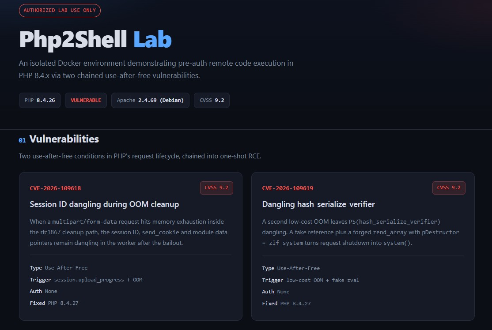

# Php2Shell-Lab

Educational Docker lab for **CVE-2026-109618** and **CVE-2026-109619**.

Pre-auth RCE (CVSS 9.2) in PHP 8.4.x. Fixed in 8.4.27.

<p align="center">
  
</p>

## Requirements

- Docker Desktop
- Python 3.9+

## Quick Start

```bash
docker compose up -d --build
```

Open: http://127.0.0.1/

## Verify

```bash
python poc/php2shell_poc.py --port 80 --container Php2Shell --cmd "id"
```

Expected:

```
[4/4] RCE OK:
uid=33(www-data) gid=33(www-data) groups=33(www-data)
```

## Structure

```
Php2Shell-Lab/
├── Dockerfile
├── docker-compose.yml
├── apache.conf
├── README.md
├── LICENSE
├── .gitignore
├── .dockerignore
├── www/
│   ├── index.php
│   └── assets/style.css
├── poc/
│   └── php2shell_poc.py
├── img/
│   └── img1.jpg
└── out/
```

## Mitigation

- Upgrade to PHP 8.4.27+
- Set `session.upload_progress.enabled=Off` as temporary mitigation
- Restrict `multipart/form-data` body sizes at the reverse proxy

## Credits

PoC based on **9bie**'s public exploit (Calif/Wiz discovery).

## License

MIT — Author: IhsanSencan